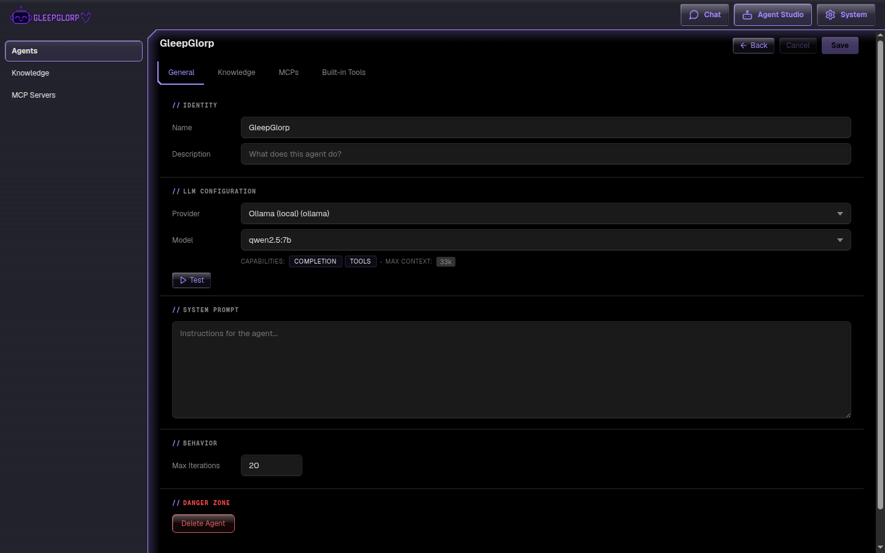
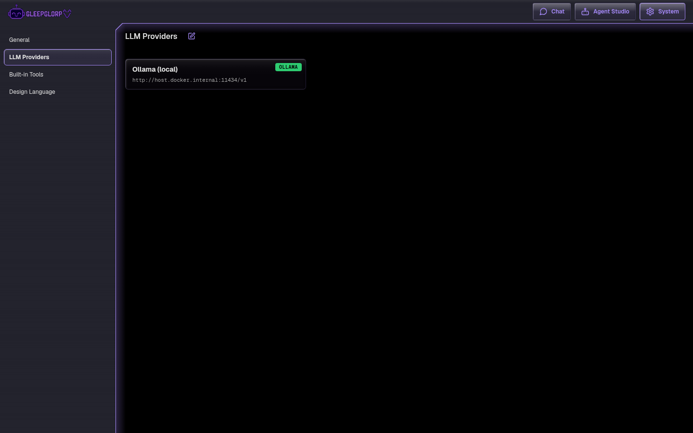

<p align="center">
  
</p>

# GleepGlorp AI

<p align="center"><em>Your local AI agent — LLM-agnostic, tool-rich, hand-rolled.</em></p>

---

## What this is

GleepGlorp AI is your local AI agent — the kind that lives on your laptop, talks to whichever LLM you point it at, and reaches into your filesystem, your shell, and the open web through a rich set of built-in tools. You give it a goal in plain English; it figures out which tools to use, calls them, reads the results, and keeps going until the work is done. Configure agents in Studio (system prompts, which tools they can touch, which model powers them), talk to them in Chat (per-session, with the full execution trace one click away), and manage providers and built-in-tool defaults in Administration. Built without agent frameworks — every layer, from the agent loop to the LLM abstraction to the tool registry, is hand-rolled in plain Python.

## Screenshots

<p align="center">
  
</p>

<p align="center">
  
</p>

<p align="center">
  
</p>

(Light theme is the default — Admin → General → Appearance has the toggle.)

## Quickstart

**Local Python** (simpler path for tinkering):

```bash
pip install -e ".[all-llms,dev]"
cp .env.example .env  # tweak THE_ONE_LLM_* defaults for your setup
the-one chat          # CLI
the-one serve         # web UI at http://localhost:8484
```

**Docker** (production-shaped path):

```bash
cp .env.example .env
make rebuild          # build image + start container at localhost:8484
make logs             # follow container logs
make down             # stop
```

The default provider is **ollama** (local models, no API key required). Add `OPENAI_API_KEY` or `ANTHROPIC_API_KEY` to `.env` to enable those cloud providers.

## Architecture

*(For implementation depth, see `CLAUDE.md` and `the_one/agents.md`. The four-layer diagram there is the canonical implementation view; the six paragraphs below are the product-shaped view for orientation.)*

**Interfaces** (`the_one/interfaces/`) — CLI (Rich + prompt-toolkit) and Web (FastAPI + WebSocket). Both use `AgentFactory.create()` to spin up agents and call `agent.step()` to drive them. The web UI is vanilla JS with hand-rolled CSS — no frameworks, no build step.

**Agent** (`the_one/agent/`) — The agent loop. User input → LLM call → tool execution → repeat, capped at 20 iterations per step as a safety limit. `AgentConfig` (Pydantic) defines provider, model, system prompt, tool selection, and behavior; `AgentFactory` resolves config from the database into a ready-to-use `Agent`.

**LLM** (`the_one/llm/`) — Abstract `LLMProvider` base with `complete()` and `stream()`. Lazy-loaded registry of three implementations: Ollama for local models, OpenAI, and Anthropic. Adding a fourth provider means adding a `*_provider.py`, registering it, and writing one wire-shape adapter — patterns established in M03.

**Tools** (`the_one/tools/`) — 19 built-in tools: filesystem (read/write/edit/glob/grep), execution (shell + PTY sessions), Python interpreter, web (fetch/download/search), and an HTTP-request escape hatch. Each tool is a `Tool` subclass with a Pydantic `Config` for operator-set defaults; per-agent overrides narrow or substitute fields at runtime.

**MCP** (`the_one/mcp/`) — Model Context Protocol client (M07). Talks to external MCP servers over stdio or streamable-HTTP; sandboxed with bubblewrap by default; OAuth pause-and-replay for servers requiring user authorization.

**Persistence** (`the_one/db/`) — SQLite via aiosqlite. Agents, providers, MCP sources, chat sessions, and a Knowledge Base index live here. API keys and MCP secrets are encrypted at rest via Fernet symmetric encryption; key rotation is exposed via `POST /api/encryption/rotate`.

## Security

GleepGlorp AI is a single-user local tool — no auth on routes by design. See [SECURITY-MODEL.md](SECURITY-MODEL.md) for the threat model, the Origin-allowlist middleware, the tool execution boundary, and what the model deliberately excludes.

## Project organization & methodology

The codebase is organized using [Mission Control](https://github.com/msieurthenardier/mission-control), an aviation-themed AI-first development methodology — missions, flights, and legs live under [`missions/`](missions/), and the per-mission artifacts there capture the design and execution history of every change.
