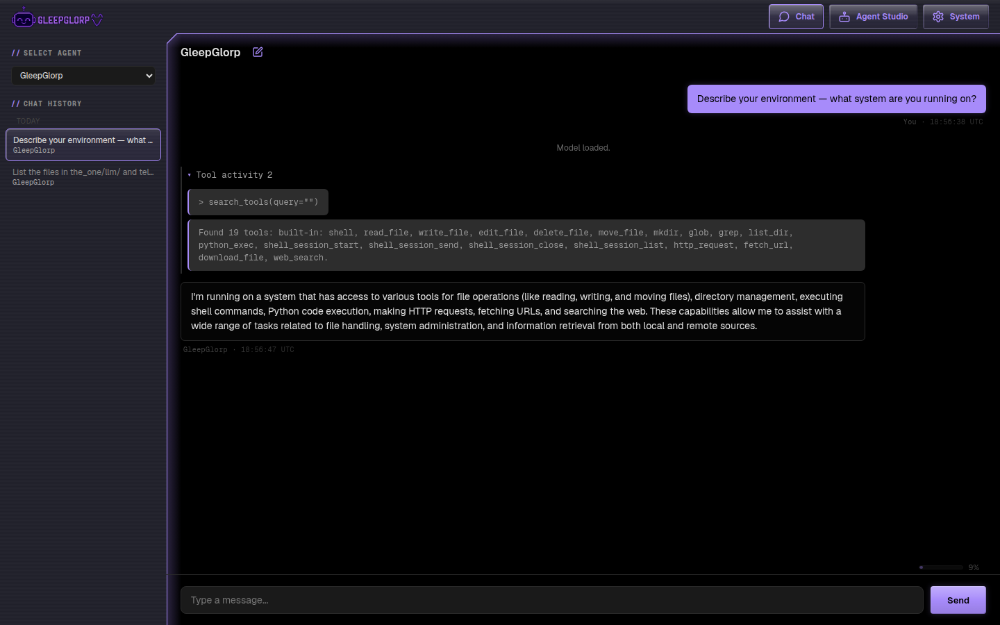

<p align="center">
  
</p>

# GleepGlorp AI

<p align="center"><em>Orchestrate your own constellation of AI agents — local, customizable, yours.</em></p>

---

## What this is

GleepGlorp AI lets you orchestrate your own constellation of AI agents — the kind that live on your laptop, talk to whichever LLM you point them at, and reach into your filesystem, your shell, and the open web through a rich set of built-in tools. You give an agent a goal in plain English; it figures out which tools to use, calls them, reads the results, and keeps going until the work is done. Configure agents in Studio (system prompts, which tools they can touch, which model powers them), talk to them in Chat (per-session, with the full execution trace one click away), and manage providers and built-in-tool defaults in Administration. No agent framework — the agent loop, tool registry, and LLM abstraction are written from scratch in plain Python on top of a small set of well-known libraries: FastAPI + uvicorn + websockets + Jinja2 for the web layer, Rich + prompt-toolkit for the CLI, Pydantic for config, aiosqlite for persistence, cryptography for at-rest secrets, httpx for HTTP, and the official MCP SDK for Model Context Protocol clients.

## Screenshots

<p align="center">
  
  <br>
  <em>Chat — talking to an agent, with the per-response tool-call trace expanded.</em>
</p>

<p align="center">
  
  <br>
  <em>Studio — configuring an agent: provider, model, capability chips, system prompt.</em>
</p>

<p align="center">
  
  <br>
  <em>Administration — managing LLM providers, built-in tools, encryption, theme.</em>
</p>

(Dark theme is the default — Admin → General → Appearance has light / dark / auto.)

## Quickstart

You'll need Python 3.11+ (for the local path) or Docker + Docker Compose (for the container path), plus at least one LLM provider configured — see [Supported LLMs](#supported-llms) below.

**Local Python** (simpler path for tinkering):

```bash
pip install -e ".[all-llms,dev]"
cp .env.example .env  # edit THE_ONE_LLM_* for your provider of choice
the-one chat          # CLI
the-one serve         # web UI at http://localhost:8484
```

**Docker** (production-shaped path):

```bash
cp .env.example .env
make rebuild          # build image + start container at localhost:8484
make logs             # follow container logs
make down             # stop
```

### Supported LLMs

GleepGlorp AI talks to four LLM providers out of the box. Pick whichever fits your setup; the app doesn't ship with any of them installed.

- **[Ollama](https://ollama.com/)** — run local models on your own machine. Install and start Ollama yourself (e.g. `ollama serve`), pull a model (e.g. `ollama pull qwen2.5:7b`), then point GleepGlorp AI at `http://localhost:11434/v1`. No API key.
- **Anthropic** — cloud Claude models. Needs an API key from console.anthropic.com.
- **OpenAI** — cloud GPT models. Needs an API key from platform.openai.com.
- **OpenRouter** — model marketplace fronting many providers. Needs an API key from openrouter.ai.

Once the app is up, configure each provider in **Administration → LLM Providers** — paste the URL and (for cloud providers) the API key into the editor. Keys are encrypted at rest in the local database via Fernet symmetric encryption; the encryption key lives at `{data_dir}/encryption.key` and can be rotated from Admin → General. Then create an agent in **Studio** that uses the provider.

## Architecture

*(For implementation depth, see `CLAUDE.md` and `the_one/agents.md`. The four-layer diagram there is the canonical implementation view; the six paragraphs below are the product-shaped view for orientation.)*

**Interfaces** (`the_one/interfaces/`) — CLI (Rich + prompt-toolkit) and Web (FastAPI + WebSocket). Both use `AgentFactory.create()` to spin up agents and call `agent.step()` to drive them. The web UI is vanilla JS with hand-rolled CSS — no frameworks, no build step.

**Agent** (`the_one/agent/`) — The agent loop. User input → LLM call → tool execution → repeat, capped at 20 iterations per step as a safety limit. `AgentConfig` (Pydantic) defines provider, model, system prompt, tool selection, and behavior; `AgentFactory` resolves config from the database into a ready-to-use `Agent`.

**LLM** (`the_one/llm/`) — Abstract `LLMProvider` base with `complete()` and `stream()`. Lazy-loaded registry of four implementations: Ollama (local models), Anthropic, OpenAI, and OpenRouter. Adding a fifth provider means adding a `*_provider.py`, registering it, and writing one wire-shape adapter — patterns established in M03.

**Tools** (`the_one/tools/`) — 19 built-in tools: filesystem (read/write/edit/glob/grep), execution (shell + PTY sessions), Python interpreter, web (fetch/download/search), and an HTTP-request escape hatch. Each tool is a `Tool` subclass with a Pydantic `Config` for operator-set defaults; per-agent overrides narrow or substitute fields at runtime.

**MCP** (`the_one/mcp/`) — Model Context Protocol client (M07). Talks to external MCP servers over stdio or streamable-HTTP; sandboxed with bubblewrap by default; OAuth pause-and-replay for servers requiring user authorization.

**Connectors** (`the_one/connectors/`) — Bi-directional communication connector framework (M10). Plugin contract + per-(agent, connector) lifecycle pool + encrypted-credentials persistence. Flight 2 ships the operator-visible admin surface (`/api/connectors` REST + Studio editor); real platform plugins (Discord, …) land in subsequent flights.

**Persistence** (`the_one/db/`) — SQLite via aiosqlite. Agents, providers, MCP sources, connectors, chat sessions, and a Knowledge Base index live here. API keys, MCP secrets, and connector secrets are encrypted at rest via Fernet symmetric encryption; key rotation is exposed via `POST /api/encryption/rotate` and atomically re-encrypts all three corpora.

## Security

GleepGlorp AI is a single-user local tool — no auth on routes by design. See [SECURITY-MODEL.md](SECURITY-MODEL.md) for the threat model, the Origin-allowlist middleware, the tool execution boundary, and what the model deliberately excludes.

## Accessibility

GleepGlorp AI targets WCAG 2.1 AA. The UI is keyboard-operable end-to-end, honors `prefers-reduced-motion` (continuous animations collapse to a static rest state), and meets minimum contrast on both light and dark themes. The Design Language gallery (Admin → Design Language, available in dev mode) is the canonical reference for tokens, components, and indicator vocabulary.

Known gaps and ongoing accessibility work are tracked in [`missions/`](missions/) under each mission's maintenance report. To report an accessibility issue, [open a GitHub issue](https://github.com/msieurthenardier/the-one/issues) with the `accessibility` label.

## Project organization & methodology

The codebase is organized using [Mission Control](https://github.com/msieurthenardier/mission-control), an aviation-themed AI-first development methodology — missions, flights, and legs live under [`missions/`](missions/), and the per-mission artifacts there capture the design and execution history of every change.
